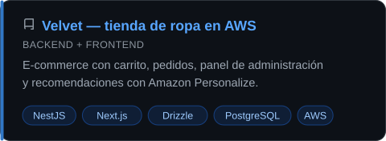
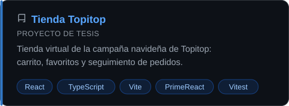
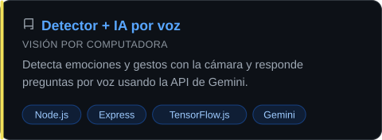
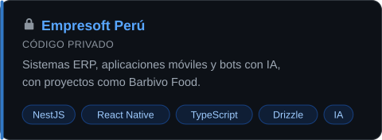
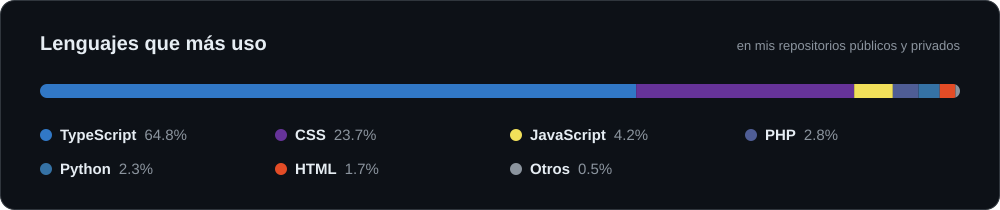

  

  <picture>
    <source media="(prefers-color-scheme: dark)" srcset="./assets/typing.svg" />
    
  </picture>

  
  
  
  

## Sobre mí

Desarrollador full stack. Desde junio de 2026 estoy a cargo del área de Tecnología y Producción en **Empresoft Perú**, donde planificamos y desarrollamos sistemas ERP, aplicaciones móviles y bots con inteligencia artificial.

- 🏢 Gerente de Tecnología y Producción en Empresoft Perú
- 🎓 Egresado de Ingeniería de Software con IA (SENATI)
- ☁️ Formación en AWS: Cloud Foundations y Cloud Operations
- 📫 luisabelvas@gmail.com

## Con qué trabajo

  

| Backend | Frontend y móvil | Bases de datos | Cloud e IA |
|---|---|---|---|
| NestJS, Node.js, Laravel | Next.js, React, React Native, Tailwind CSS | PostgreSQL, MySQL, Drizzle ORM | AWS, Linux, integración de IA, bots |

## Proyectos destacados

  
  
  
  

## Estadísticas

  

## Certificaciones

  
  
  
  

  

